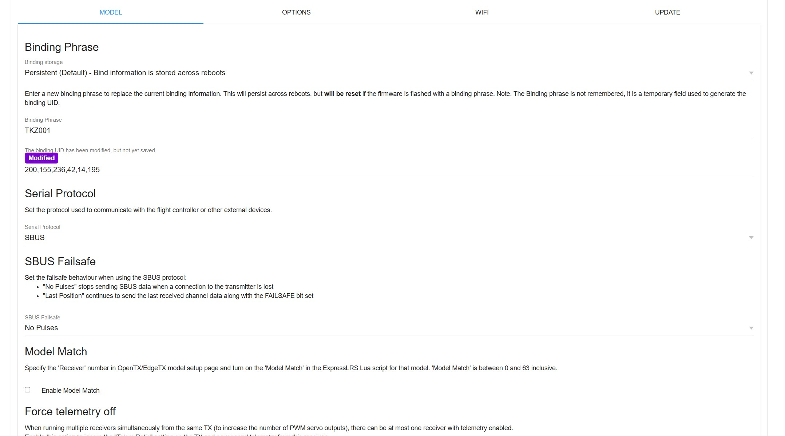

nano 接收机的配对字（Binding Phrase）用来在接收机内部生成绑定 UID：接收机与遥控器两侧填写的配对字一致，才能正常绑定。它在 WebUI 的 `MODEL` 页里配置，改完必须保存。

## 本次使用的配置

| 参数 | 取值 |
| --- | --- |
| Binding storage | `Persistent (Default)`，绑定信息跨重启保留 |
| Binding Phrase | `TKZ001` |
| Serial Protocol | `SBUS` |
| SBUS Failsafe | `No Pulses` |
| Model Match | 未勾选，即未启用 |

## 两个容易踩的点

> [!IMPORTANT]
> 配对字本身不会被记住，它只是生成绑定 UID 的临时字段；如果刷写固件时带着配对字，已有的绑定信息会被重置。上图的紫色 `Modified` 标签表示 UID 已经改变但**尚未保存**，配置完必须确认这个提示消失。

- **Serial Protocol**：这里选的是 `SBUS`，飞控侧的接收机协议必须与它保持一致，否则接收机看起来有输出、飞控却读不到通道。
- **SBUS Failsafe**：`No Pulses` 表示遥控失联后接收机停止发送 SBUS 数据；另一个选项 `Last Position` 会继续发送最后一帧通道数据并置 FAILSAFE 位，失控判断就完全依赖飞控对 FAILSAFE 位的处理。

接线、供电与固件版本以实际装机为准，本页只记录软件侧的取值。
