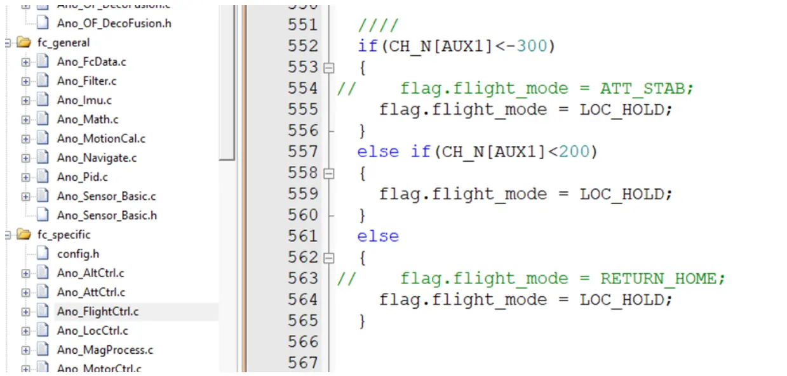
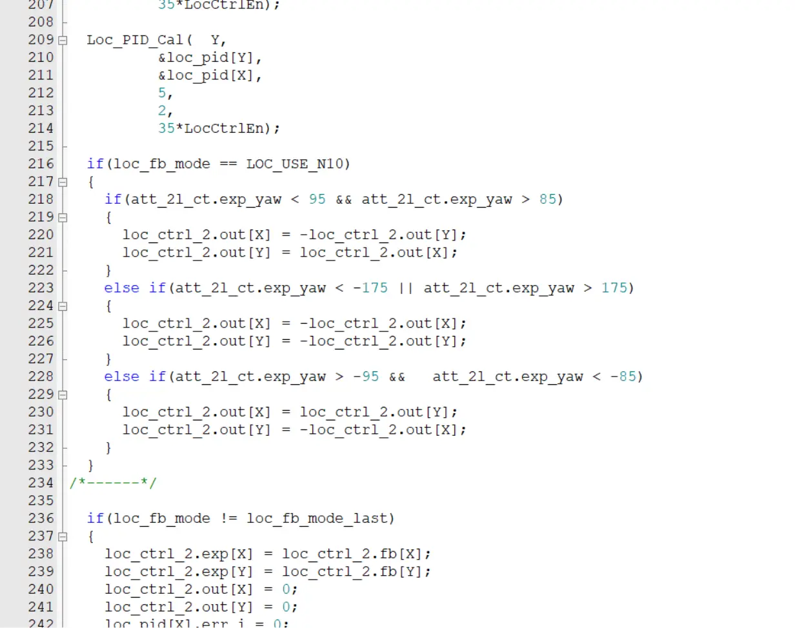

这篇文档面向的是**匿名飞控**代码，按“任务调度分层”和“数据流方向”两条线索梳理。需要注意学长改版与匿名官方原版在三处行为上并不一致，下面每处都会单独标出：标注为改版有问题的地方，**不要直接照用**。

## 飞控总任务执行流程

整个飞控使用**时间片轮转调度**：所有任务被分配到 7 个频率级别，`Scheduler_Run()` 在 `main.c` 的 `while(1)` 中不断被调用，通过 SysTick 检查各任务是否到点，到点则执行。

| 频率 | 周期 | 这一层做什么 |
| --- | --- | --- |
| 1000Hz | 1ms | 最高优先级：传感器读取 + IMU + 状态 |
| 500Hz | 2ms | 姿态角速度环 + 电机输出（最内层控制） |
| 200Hz | 5ms | 姿态角度环 + 遥控数据 + 高度融合 |
| 100Hz | 10ms | 高度环 + 飞行模式 + LED |
| 50Hz | 20ms | 位置/速度环 + 磁力计 + 程序指令；**★ 你的用户位置环和用户任务在这里 ★** |
| 20Hz | 50ms | 电源管理 + 恒温 |
| 2Hz | 500ms | 参数延时存储（最慢） |

频率越高、周期越短，越靠近传感器和姿态内环；频率越低越慢，处理的是外环控制、管理和存储。

## 数据流全景：从传感器读取到电机输出

下面的编号保留原文档的顺序，逐层从高频流向低频，最后回到电机输出。

### 1000Hz — 传感器与姿态解算层

1. `Fc_Sensor_Get()`：读取 ICM20602 加速度/陀螺仪原始数据，以及 SPL06 气压计、AK8975 磁力计。
2. `Sensor_Data_Prepare(1)`：数据校准、零偏修正。
3. `IMU_Update_Task(1)`：四元数 + 姿态解算（核心），输出 `imu_data.rol/pit/yaw/acc`。
4. `WCZ_Acc_Get_Task()`：计算世界坐标系 Z 加速度；`WCXY_Acc_Get_Task()`：计算世界坐标系 XY 加速度。
5. `Flight_State_Task(1)`：读取 `CH_N[]` 摇杆值，输出 `fs.speed_set_h`。
6. `Swtich_State_Task(1)`：光流/GPS/UWB 在线检测，输出 `switchs.xxx_on`。
7. `ANO_OF_Data_Prepare_Task`：光流数据准备，输出 `of_rdf.ground_vel_est`。
8. `ANO_DT_Task1Ms()`：数传数据交换（与上位机通信）。

### 500Hz — 最内层角速度环

9. `Att_1level_Ctrl(2ms)`：角速度 PID（最内环，响应最快），输出 `mc.ct_val_rol/pit/yaw`（控制量）。
10. `Motor_Ctrl_Task(2)`：混控 + PWM 输出到电机，`motor[1-4] = mc.ct_val_thr ± ...`。
11. `Ano_UWB_Get_Data_Task()`：UWB 定位数据接收。

### 200Hz — 姿态角度环 + 高度融合

12. `calculate_RPY()`：把四元数转换为欧拉角 `rol/pit/yaw`。
13. `Att_2level_Ctrl(5ms)`：姿态角度 PID（中环），输出目标角速度，作为 `Att_1level_Ctrl` 的期望输入。
14. `DrvRcInputTask()`：遥控输入信号处理。
15. `WCZ_Fus_Task(5)`：高度互补滤波（加速度 + 气压 + TOF 融合），输出 `wcz_hei_fus.out`（融合高度）与 `wcz_spe_fus.out`（融合速度）。

### 100Hz — 高度外环 + 系统状态

16. `RC_duty_task(10)`：遥控摇杆占空比计算，输出 `CH_N[]`。
17. `Flight_Mode_Set(10)`：根据 AUX1/AUX2 设置飞行模式，输出 `flag.flight_mode`（`LOC_HOLD`/`RETURN...`）。
18. `Alt_1level_Ctrl(10ms)`：高度速度 PID（高度内环）。
19. `Alt_2level_Ctrl(10ms)`：高度位置 PID（高度外环，起飞控制），输出 `loc_ctrl_2.out[Z]`。
20. `AnoOF_Check_State()`：光流通信状态检测。
21. `LED_Task2(10)`：LED 状态显示（模式闪烁 + 外设指示）。

### 50Hz — 位置/速度外环 + 用户任务

22. `Mag_Update_Task(20)`：磁力计校准和数据更新。
23. `FlyCtrl_Task(20)`：程序指令控制（上位机发来的飞行指令），输出 `program_ctrl.vel_cmps_h[X/Y/Z]`。
24. `ANO_OFDF_Task(20)`：光流融合和数据处理。
25. `Loc_1level_Ctrl(20, CH_N)`：XY 位置速度 PID（官方位置环）；无光流时进入姿态模式，有光流时走速度闭环，输出 `loc_ctrl_1.out[X/Y]`（倾角目标）。

**用户代码在这一层**：

26. `User_Loc_2Ctrl_Task()`：用户位置环 PID（N10 位置反馈），输出 `loc_ctrl_2.out[X/Y]`（速度修正量）。
27. `User_Yaw_3Ctrl_Task()`：用户航向 PID（覆盖官方航向控制）。
28. `LocCtrlEn = true` 为用户位置环使能标志，`YawCtrl_En = true` 为用户航向环使能标志。
29. `EmergencyLand_Check_Task`：紧急迫降检测（安全监控）。
30. `UserTask_50ms`：自定义 50ms 任务（OpenMV 处理等），属于用户任务调度。

### 20Hz — 电源管理 + 恒温控制

31. `Power_UpdateTask(50)`：电池电压检测 + 低电量告警。
32. `Thermostatic_Ctrl_Task`：IMU 恒温控制（保持温度稳定，减少零漂）。
33. `UserTask_50ms`：自定义 50ms 任务（原文档在这一层重复列出，此处按原文保留）。

### 2Hz — 慢速参数持久化

34. `Ano_Parame_Write_task`：参数延时写入 Flash（避免频繁擦写）。

## 飞控模式设置

> [!WARNING]
> `Ano_FlightCtrl.c` 中的 `flag.flight_mode` 控制自稳、定高、程控等飞行模式。**目前，这里的判断逻辑改成了强制启动定高模式**：三个分支都写死 `LOC_HOLD`。匿名官方代码是正常的，各模式的对应关系请参考拓空者 P2 手册。



## 雷达坐标系变换问题



学长改版代码中 `Loc_Ctrl.c` 的这段逻辑会造成写入覆盖，导致坐标系变换异常：旋转时先写了 `loc_ctrl_2.out[X]`，后面计算 `out[Y]` 又读回已经被覆盖的 `out[X]`。加上缓存变量即可：

```c
if (loc_fb_mode == LOC_USE_N10)
{
    float tmp_x = loc_ctrl_2.out[X];
    float tmp_y = loc_ctrl_2.out[Y];

    if (att_2l_ct.exp_yaw < 95 && att_2l_ct.exp_yaw > 85)
    {
        loc_ctrl_2.out[X] = -tmp_y;
        loc_ctrl_2.out[Y] = tmp_x;
    }
    else if (att_2l_ct.exp_yaw < -175 || att_2l_ct.exp_yaw > 175)
    {
        loc_ctrl_2.out[X] = -tmp_x;
        loc_ctrl_2.out[Y] = -tmp_y;
    }
    else if (att_2l_ct.exp_yaw > -95 && att_2l_ct.exp_yaw < -85)
    {
        loc_ctrl_2.out[X] = tmp_y;
        loc_ctrl_2.out[Y] = -tmp_x;
    }
}
```

## 位置环输出的数据注入流程

从用户位置环写出的速度修正量，最终怎样变成电机 PWM：

```text
User/Loc_Ctrl.c
└→ loc_ctrl_2.out[X/Y]                        ← 你的位置 PID 输出 (cm/s)
   │
   ▼
Ano_FlightCtrl.c:296-297
└→ speed_set_tmp[X/Y] = 遥控 + program_ctrl + pc_user + loc_ctrl_2.out
   │
   ▼
Ano_FlightCtrl.c:299-302
└→ fs.speed_set_h[X/Y]                        ← 最终水平速度目标 (cm/s)
   │
   ▼
Ano_LocCtrl.c:104-400 (Loc_1level_Ctrl)
└→ loc_ctrl_1.out[X/Y]                        ← 速度环 PID 输出 (角度目标，度)
   │
   ▼
Ano_AttCtrl.c:274-322 (Att_1level_Ctrl)
└→ mc.ct_val_rol / ct_val_pit / ct_val_yaw    ← 姿态 PID 输出
   │
   ▼
Ano_MotorCtrl.c:108-136
└→ motor_step[m1..m4] = mc.ct_val_thr ± ct_val_rol ± ct_val_pit ± ct_val_yaw
   │
   ▼
硬件 PWM → 电机转动
```

## 本篇总结

- 任务按 7 个频率级别轮转：1000Hz 负责传感与姿态解算，500Hz 是最内层角速度环，200Hz 补姿态角度环与高度融合，100Hz 往下进入高度环、模式、位置速度环与管理任务，2Hz 只做参数持久化。
- 用户位置环与用户任务挂在 50Hz 层，位置 PID 的输出经 `Ano_FlightCtrl.c` 汇总进 `fs.speed_set_h`，再逐级转为角度目标、姿态控制量和电机 PWM。
- 使用学长改版代码前必须先确认三处改动：飞行模式被强制为定高、`wcz_hei_fus.out` 的融合高度不可用、`Loc_Ctrl.c` 的坐标系变换存在写入覆盖。
